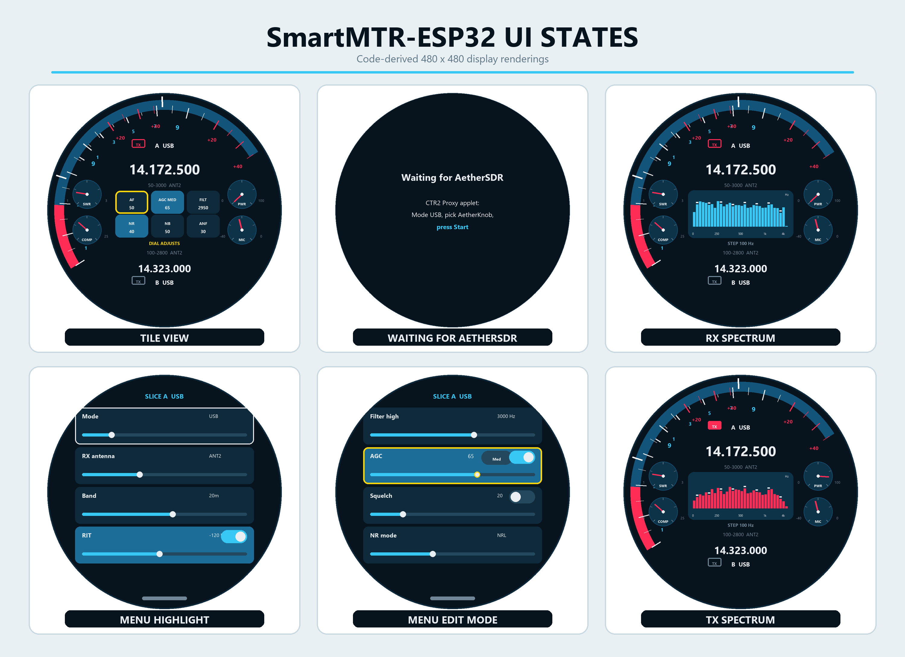

# SmartMTR-ESP32 User Manual

This manual describes the current SmartMTR-ESP32 device, also called
“AetherKnob.” It is for radio amateurs who want to use the controller with
AetherSDR and a FlexRadio. It is an operating manual, not a development guide.

## Scope and verification status

The control logic, SmartSDR protocol handling, menu commands, meter movement,
CTR2 data handling, and spectrum helpers are implemented and covered by
offline tests. A desktop preview with scripted touch and dial actions is also
included in the project.

The following items have not yet been proven on the real target hardware:
display startup, touch orientation, encoder counts per detent, and UDP meter
data carried through CTR2. This manual marks these areas as **implemented but
not yet hardware-verified**. A successful firmware build or desktop preview
does not replace a test on the real CrowPanel.

## UI overview



*Source-based UI renderings, not hardware photographs.*

## 1. Device overview

SmartMTR-ESP32 is a display and control unit for a FlexRadio station. It runs
on the **Elecrow CrowPanel 2.1\" HMI ESP32 Rotary Display** (DHE03921D). The
board has an ESP32-S3, a round 480×480 IPS touch screen, and a rotary dial that
can also be pressed. The round display design is based on SmartMTR by Dariusz
Socha, SQ5X.

The controller does not connect directly to the radio by Wi-Fi or Ethernet.
It connects by USB to the PC running AetherSDR. The **CTR2 Proxy** applet in
AetherSDR carries status information, meter data, and control commands between
AetherKnob and the FlexRadio. AetherKnob works as a separate SmartSDR API
client and binds to the active AetherSDR or SmartSDR GUI station.

## 2. Connections and controls

| Item | Purpose |
| --- | --- |
| Round display | Shows up to two slices, meters, spectrum or tiles, connection status, and the menu. |
| Touch screen | Supports tap, touch-and-hold, and swipe gestures. |
| Rotary dial | Tunes the radio, changes values, and moves through the menu. One mechanical detent is intended to produce one control step, but this is not yet hardware-verified. |
| Dial push button | Supports a short click and a press-and-hold of at least 0.6 seconds. |
| **USB-5V-IN** (4-pin MX1.25) | Supplies power and provides the native USB connection to the PC through the supplied MX1.25-to-USB cable. It is also the flashing port. |
| **UART** (4 pins: RX, TX, 5V, GND) | Provides firmware logs at 115200 baud. Use a 3.3 V USB-to-serial adapter and do not connect its power output to the board’s 5 V pin. |
| **I2C** (4 pins: SCL, SDA, 5V, GND) | Spare expansion connector. The same bus already contains the touch controller at address 0x15 and the PCF8574 at 0x21. |
| **RESET** | Restarts the device. Used with BOOT to enter the ROM download mode. |
| **BOOT** | Hold this button while resetting to enter flashing mode. |

When the firmware is running, the native USB port is a vendor-specific HID
device. It does not provide the normal USB serial console. Firmware logs are
available on the UART connector instead.

## 3. Powering up and connecting

1. Switch on the FlexRadio and start AetherSDR on the PC.
2. Connect AetherSDR to the required FlexRadio station.
3. Connect AetherKnob to the PC through **USB-5V-IN**.
4. Open the **CTR2 Proxy** applet in AetherSDR.
5. Set **Mode** to **USB**.
6. Select **AetherKnob**, shown by USB as **AETHER_KNOB**.
7. Press **Start**.

Expected display states:

| Display | Meaning |
| --- | --- |
| `AetherKnob – Plug into the PC running AetherSDR` | No USB host is connected, or the USB connection has been removed. |
| `Waiting for AetherSDR` with CTR2 Proxy instructions | USB is connected, but CTR2 Proxy has not started the link. |
| `Radio connected – Waiting for a SmartSDR or AetherSDR station` | The radio is reachable through the proxy, but no suitable GUI station has been bound yet. |
| Round meter face with no status overlay | AetherKnob is bound to a station and ready to use. |

The startup and binding behavior is implemented and offline-tested. The full
chain with the real panel, AetherSDR, and a FlexRadio has not yet been recorded
as a completed hardware test in this project.

## 4. Main display

The top slice area shows the active slice of the bound station. If the station
does not report an active slice, AetherKnob uses the first slice that belongs
to that station. A second slice from the same station is shown at the bottom
when one is available.

| Display item | Meaning |
| --- | --- |
| Large frequency | Slice frequency in `MHz.kHz.Hz` format. |
| Slice letter and mode | For example, `A USB`. |
| Filter and antenna line | Lower and upper filter edges, followed by the RX antenna. |
| S-meter arcs | Receive level for each slice, linear in dB from S0 to S9+40. The white marker shows the held peak. |
| **SWR** | Standing wave ratio, scale 1 to 3. |
| **COMP** | Compression level, scale 0 to 25 dB. |
| **PWR** | Forward power, scale 0 to 100 W. |
| **MIC** | Microphone level, scale −40 to 0 dB. |
| **TX** beside a slice | Shows and selects the transmit slice. See section 11. |
| `STEP … Hz` | Current tuning step. |
| `DIAL ADJUSTS` | The dial is changing a selected parameter instead of tuning. |
| `LOCKED` | Tuning is locked for the active slice. |
| Center area | Audio spectrum or six quick-control tiles. |

## 5. Using the rotary dial

### On the main display

| Action | Result |
| --- | --- |
| Turn the dial | Tunes the active slice by one tuning step for each detected detent. Turning has no tuning effect while the slice is locked. |
| Short click | Selects the next tuning step: 10, 50, 100, 500, 1000, 5000, 10000 Hz, then back to 10 Hz. |
| Hold for at least 0.6 seconds | Turns **Tune lock** on or off for the active slice. |
| Turn while a tile has a yellow outline | Changes the selected tile parameter instead of frequency. |
| Short click in parameter mode | Leaves parameter mode, so the dial tunes again. |

Tapping the same yellow-outlined tile also returns the dial to tuning. Encoder
direction and the number of electrical counts per mechanical detent are set in
the firmware but have not yet been confirmed on the real panel.

### In the menu

When no row has a yellow edit outline, turning moves the white highlight.
Clicking the dial starts editing the highlighted row. Turning then changes its
value. See section 8 for full menu operation.

## 6. Touch operation

| Gesture | Result on the main display |
| --- | --- |
| Tap a tile | Assigns that parameter to the rotary dial and gives the tile a yellow outline. Tap it again to return the dial to tuning. |
| Touch and hold a tile | Runs the tile’s quick action. See section 7. |
| Tap a **TX** label | Makes that slice the transmit slice. The slice must belong to the bound station. |
| Swipe down | Opens the menu when the device is bound to a station. |
| Swipe left or right | Switches between spectrum and tiles. If no current spectrum is available, the tiles remain visible. |
| Tap the spectrum | Shows the tiles. |

In the menu, swipe vertically to scroll the list. A vertical swipe that begins
on a slider can still take over as list scrolling. Drag a slider sideways to
change it. Tap switches and the AGC mode button.

Touch coordinates and gestures are implemented and can be exercised in the
desktop preview, but touch orientation is not yet verified on the CrowPanel.

## 7. Tiles and quick controls

The value shown on each tile belongs to the active slice.

| Tile | Tap, then turn the dial | Touch and hold |
| --- | --- | --- |
| **AF** | Changes audio level from 0 to 100 | Steps the AGC mode: off → slow → med → fast → off. AF has no separate on/off switch. |
| **AGC** | Changes AGC threshold from 0 to 100. When AGC is off, it changes fixed receive gain instead. | Steps the AGC mode. |
| **FILT** | Changes filter width symmetrically around the passband center in 50 Hz steps, limited to 50–12000 Hz. | Selects the next tuning step. |
| **NR** | Changes NR level from 0 to 100. | Turns NR on or off. |
| **NB** | Changes NB level from 0 to 100. | Turns NB on or off. |
| **ANF** | Changes ANF level from 0 to 100. | Turns ANF on or off. |

An enabled function has a brighter tile background. A yellow outline means
only that the tile’s parameter is currently assigned to the rotary dial.

## 8. Menu

### Opening, closing, and scrolling

- Swipe down on the bound main display to open the menu.
- Swipe up or down in the list to scroll.
- Tap the grip at the bottom, or swipe upward from it, to close the menu.
- You can also hold the dial when no row is being edited.
- The menu closes after 8 seconds without touch or dial activity.
- It also closes if the station binding is lost.

Closing the menu normally confirms any pending list choice. Holding the dial
while editing does something different: it leaves edit mode and discards a
list choice that has not yet been sent.

### Editing by touch

- Tap a value or choice row to assign it to the dial.
- Tap the same row again to leave edit mode.
- Drag a slider sideways to change a level. Level changes are sent while you
  drag. A list choice is shown in yellow and sent when you lift your finger.
- Tap a switch to turn a function on or off.
- Tap the small AGC mode button to step through `Off`, `Slow`, `Med`, and
  `Fast`.
- On a combined level-and-switch row, touching and holding the row also toggles
  its on/off setting.

### Editing with the rotary dial

- **White outline:** the row is highlighted, but not being edited. Turn the
  dial to move through the list. The list scrolls to keep the row visible.
- **Yellow outline:** the row is being edited. Turn the dial to change its
  value or choice. For a plain on/off row, clockwise means on and
  anticlockwise means off.
- Short-click a white row to start editing it.
- On a combined level-and-switch row, a short click while editing toggles the
  switch and leaves the level assigned to the dial.
- On the AGC row, a short click while editing steps the AGC mode and leaves
  the level assigned to the dial.
- On other rows, a short click ends editing and immediately sends a previewed
  choice. Without a click, a dial-selected choice is sent after the dial has
  been still for 0.7 seconds.
- Hold the dial while editing to go back and discard a choice that has not yet
  been sent.

Yellow value text is a list choice that has not yet been finally sent. A
brighter row background means the function is enabled; it is separate from
the yellow edit outline.

## 9. Menu items

The names below are exactly the names shown on the device.

### Receive

| Item | Purpose and range |
| --- | --- |
| **Mode** | Selects a mode from the list supplied by the radio. |
| **RX antenna** | Selects a receive antenna from the list supplied by the radio. |
| **Band** | Selects 160 m, 80 m, 60 m, 40 m, 30 m, 20 m, 17 m, 15 m, 12 m, 10 m, 6 m, WWV, or GEN. The radio may recall a band stack and recreate the slice. |
| **RIT** | On/off and −9990 to +9990 Hz in 10 Hz steps. |
| **Filter low** | Lower filter edge from −12000 to +12000 Hz in 50 Hz steps. Hidden in FM and NFM. |
| **Filter high** | Upper filter edge from −12000 to +12000 Hz in 50 Hz steps. Hidden in FM and NFM. Minimum filter width is 50 Hz; allowed limits also depend on mode and, for CW, pitch. |
| **AGC** | Off/Slow/Med/Fast mode and level 0–100. With AGC off, the level is fixed receive gain. Otherwise it is the AGC threshold. |
| **Squelch** | On/off and threshold 0–100. |
| **NR mode** | Off, NR, NRL, NRS, RNN, or NRF. NRL/NRS/RNN/NRF are FLEX-8000/Aurora functions and are ignored by a FLEX-6000. |
| **NR amount** | Level 0–100 for the active NR type, where that type has an adjustable level. |
| **ANF mode** | Off, ANF, ANFL, or ANFT. ANFL/ANFT are FLEX-8000/Aurora functions and are ignored by a FLEX-6000. |
| **ANF amount** | Level 0–100 for the active ANF type, where that type has an adjustable level. |
| **WNB** | Wide Noise Blanker on/off and level 0–100. |
| **APF** | Audio Peak Filter on/off and level 0–100. Visible only in CW modes. |
| **Mute** | Turns audio for the active slice on or off. |
| **Pan** | Stereo position 0–100 in steps of two. The display runs from `L100` through `L2`, then `C`, then `R2` through `R100`. |
| **Diversity** | Turns diversity on or off for the active slice. |
| **DAX channel** | Off or channel 1–8. |
| **Tune lock** | Locks or unlocks frequency tuning for the active slice. |

### Transmit

| Item | Purpose and range |
| --- | --- |
| **RF power** | Transmit power 0–100. |
| **Tune power** | TUNE power 0–100. This sets only the power value; it does not start TUNE. |
| **Mic gain** | Microphone gain 0–100. |
| **Compander** | On/off and level 0–100. |
| **Monitor** | Transmit monitor on/off and level 0–100. |
| **TX antenna** | Selects a transmit antenna from the list supplied by the radio. |
| **XIT** | On/off and −9990 to +9990 Hz in 10 Hz steps. |

### CW-only items

| Item | Purpose and range |
| --- | --- |
| **CW speed** | 5–100 WPM in steps of one. |
| **CW pitch** | 100–6000 Hz in 10 Hz steps. |
| **Break-in** | Turns CW break-in on or off. |

## 10. Spectrum display

When AetherSDR supplies the negotiated spectrum extension, the center area
shows a 32-bar audio spectrum with white peak markers. The RX spectrum shows
the received audio after DSP, noise reduction, and the RX chain up to and
including the equalizer. While transmitting, it shows the TX audio in red
across the TX filter width.

During receive, the frequency scale runs from 0 Hz to the active slice’s
filter width, with a maximum of 12 kHz. The bars are spaced logarithmically by
frequency. The lower useful edge is about one-sixtieth of the full span. The
axis labels adjust to the current span. Bar height represents a dB value. Peak
markers fall gradually.

- Tap the spectrum to show the tiles.
- Swipe left or right to switch between spectrum and tiles.
- If the tiles have not been used for 8 seconds and a stable spectrum is
  available, the spectrum returns. It does not return automatically while a
  tile parameter is assigned to the dial.
- If no new spectrum frame arrives for 5 seconds, the display changes to the
  tiles.
- A new stream must remain stable for 1.5 seconds before the display switches
  back automatically.
- If AetherSDR supplies no spectrum extension data, the tiles remain visible.

Spectrum generation and handling are implemented and offline-tested. The real
spectrum path through AetherSDR and USB/CTR2 has not yet been hardware-verified.
A standard CTR2 does not provide this extension.

## 11. Transmit-related behavior

Each displayed slice has a **TX** label:

| Appearance | Meaning |
| --- | --- |
| Gray outline | This is not the transmit slice. Tap it to select this slice for transmit. |
| Red outline | This is the selected transmit slice, but the radio is not currently transmitting. |
| Solid red with white text | The radio reports that it is transmitting on this TX slice. |

Only an existing slice belonging to the bound GUI station can be selected as
the TX slice from this display. The TX label reports and selects the TX slice;
it is not a PTT button.

**The menu never keys the transmitter.** It has no VOX switch and no command
that starts TUNE. **Tune power** changes only the stored TUNE power setting.
Use the normal PTT, VOX, or TUNE control outside this menu to start
transmitting.

## 12. Status displays and common states

| State | What you see | What to do |
| --- | --- | --- |
| No USB host | `Plug into the PC running AetherSDR` | Check the USB cable and PC connection. |
| Waiting for AetherSDR | `Waiting for AetherSDR` | Set CTR2 Proxy to USB/AetherKnob and press Start. |
| Radio but no station | `Radio connected … Waiting for a … station` | Connect or select a GUI station in AetherSDR or SmartSDR. |
| Connected | The status overlay disappears and the round meter face is visible. | The controller is ready. |
| Locked | Yellow `LOCKED` text | Hold the dial or turn off **Tune lock** in the menu. |
| Transmitting | TX label is solid red; spectrum bars are red when TX spectrum data is available. | Status only; it does not key the transmitter. |
| No spectrum | Tiles remain visible. | Radio control can still work normally. Check spectrum extension support if needed. |

## 13. Troubleshooting

### The PC does not detect the device

1. Use the **USB-5V-IN** connector and try a direct PC connection.
2. Check whether the display or backlight starts. If the device appears dead,
   check the power source and cable.
3. Press **RESET** once and wait for USB detection again.
4. If the PC shows `USB JTAG/serial debug unit`, follow the bootloader steps
   below.

### CTR2 Proxy does not list AetherKnob

- AetherSDR must support the **AETHER_KNOB** USB product string.
- Select **Mode: USB**, then reopen or refresh the device list.
- Close other programs that may have opened the HID device. Unplug and
  reconnect AetherKnob, then restart CTR2 Proxy.
- Check that the board is not still running as the ROM USB serial/JTAG device.

### The display stays on “Waiting for AetherSDR”

- Open CTR2 Proxy, select USB mode and AetherKnob, then press **Start**.
- Stop and restart the proxy link, or safely reconnect AetherKnob.
- If the display changes to `Radio connected`, the USB/CTR2 path is working.
  The remaining problem is that no AetherSDR or SmartSDR GUI station has been
  bound.

### Touch direction is wrong

The firmware currently uses the touch controller’s X and Y coordinates
without a user calibration or rotation setting. Wrong orientation is a known
pending hardware check and cannot be corrected in the device menu. Record
which physical directions produce which screen movements before changing the
firmware configuration.

### The rotary dial counts incorrectly or runs backward

The current setting uses four quadrature edges per mechanical detent and
reverses the hardware count direction. These settings are not yet
hardware-verified and cannot be changed from the device menu. Check whether
one detent produces exactly one step and whether clockwise rotation increases
frequency or value. A mismatch is a firmware/board calibration issue, not a
radio fault.

### The device remains in the bootloader or USB JTAG/serial mode

- Release **BOOT**, then press **RESET** once.
- If needed, run
  `python -m esptool --port <COM-port> --after watchdog-reset chip-id`, then
  press **RESET** again.
- In normal operation, the device should reappear as
  **AetherSDR AETHER_KNOB**, not `USB JTAG/serial debug unit`.

### The spectrum is missing

- Radio control may still work. The controller intentionally shows tiles when
  no current spectrum data is available.
- A sideways swipe can select the spectrum only while current spectrum data
  exists.
- AetherSDR and CTR2 Proxy must negotiate the AetherKnob spectrum extension.
  A standard CTR2 does not supply it.
- If no spectrum appears after several seconds, test the other controls and
  treat the still-unverified extension/USB data path as a possible cause.

### There is no radio control

- Note whether the display says `Waiting for AetherSDR`, `Radio connected`, or
  shows the full round meter face.
- Make sure a suitable GUI station and at least one slice exist in AetherSDR.
  AetherKnob controls only slices belonging to the bound station.
- `LOCKED` blocks frequency tuning only. Other controls should still work.
- Stop CTR2 Proxy, reset AetherKnob or disconnect USB once, then start the
  proxy again with USB/AetherKnob selected.

### Safe reset and reconnect procedure

1. If the radio is transmitting, stop transmission with the normal PTT, VOX,
   or TUNE control.
2. Stop CTR2 Proxy.
3. Press **RESET** once. If necessary, unplug and reconnect USB.
4. Wait for `Waiting for AetherSDR`.
5. Start CTR2 Proxy again with USB/AetherKnob selected.

## 14. Firmware update and flashing

You need an ESP-IDF environment version 6.0 or later. The repository does not
currently declare a stable release version.

1. Connect AetherKnob to the PC by USB.
2. Hold **BOOT**.
3. Press and release **RESET**.
4. Release **BOOT**. The ESP32-S3 ROM should now appear as a USB serial/JTAG
   device and provide a COM port on Windows.
5. Find the new COM port.
6. Open an ESP-IDF command prompt in the project directory, then build and
   flash:

   ```powershell
   idf.py build
   idf.py -p COMx flash
   ```

   Replace `COMx` with the actual port.
7. After flashing completes, press **RESET** once.
8. Allow about 3 seconds for USB to reconnect. The expected device is
   **AetherSDR AETHER_KNOB**, with USB product name **AETHER_KNOB**.

If the device remains listed as `USB JTAG/serial debug unit`, it is still in
download mode. Release **BOOT** and press **RESET** again. If required, use the
`esptool` command from the troubleshooting section. Runtime logs are then
available from the UART connector at 115200 baud, not from the native USB HID
connection.

## 15. Known limitations

- Display startup on the real CrowPanel is not yet recorded as verified.
- Touch orientation and gestures are not yet confirmed on the target device.
  There is no user touch calibration in the menu.
- Encoder direction and four counts per detent are not yet calibrated on the
  target device.
- Meter data through the relayed UDP path, including live meter updates, is not
  yet hardware-verified.
- The spectrum path is implemented and offline-tested, but the real
  AetherSDR/USB path is not yet hardware-verified.
- The controller depends on AetherSDR CTR2 Proxy. It has no direct network
  connection to the radio.
- NRL, NRS, RNN, NRF, ANFL, and ANFT are intended for FLEX-8000/Aurora radios.
  A FLEX-6000 ignores these commands.
- The menu does not key the transmitter. VOX and starting TUNE are deliberately
  absent.
- The repository does not declare a stable release version.

## 16. Quick reference

| Action | Result |
| --- | --- |
| Turn the dial | Change frequency by the current tuning step. |
| Short-click the dial | Select the next tuning step; in parameter mode, return to tuning. |
| Hold the dial for at least 0.6 s | Toggle Tune lock; in the menu, go back or close the menu. |
| Tap a tile | Assign its parameter to the dial; tap again to leave parameter mode. |
| Hold NR, NB, or ANF | Turn that function on or off. |
| Hold AF or AGC | Step the AGC mode. |
| Hold FILT | Select the next tuning step. |
| Tap a TX label | Select that slice as the TX slice. |
| Swipe down | Open the menu. |
| Swipe left or right | Switch between spectrum and tiles when spectrum data is available. |
| Tap the spectrum | Show the tiles. |
| Swipe the menu up or down | Scroll the list. |
| White menu outline | Row is highlighted; the dial moves through the menu. |
| Yellow menu outline | Row is being edited with the dial. |
| Tap or swipe up from the bottom grip | Close the menu. |

## 17. First-use checklist

- [ ] Switch on the FlexRadio.
- [ ] Start AetherSDR and connect it to the required station.
- [ ] Connect AetherKnob to the PC through **USB-5V-IN**.
- [ ] Wait for `Waiting for AetherSDR`.
- [ ] Open **CTR2 Proxy** in AetherSDR.
- [ ] Select **Mode: USB**.
- [ ] Select **AetherKnob / AETHER_KNOB**.
- [ ] Press **Start**.
- [ ] Wait until the status overlay disappears and the round meter face appears.
- [ ] Check that the required active slice is shown at the top.
- [ ] Turn the dial carefully by one detent and confirm one tuning step.
- [ ] If the wrong slice is active, select it in AetherSDR first. Tap a TX label
      only when you also intend to change the transmit slice.

